# Rencana penerimaan M0-D dan integrasi M0-F

**Arah terbaru — PRD v1.6, 2026-11-25:** pola development adalah Planner mahal → Issue READY → pilih Worker murah dalam chat yang sama → implementasi/tes/PR → Reviewer mahal di chat lain → koreksi pada PR yang sama. Worker murah berlaku saat aplikasi diizinkan; pekerjaan fondasi workflow saat ini tetap target mahal. Handoff peran dan model aktual dicatat terpisah meskipun ID chat sama. [Issue #6](https://github.com/MuhammadZidniirfan05-dot/batani-company/issues/6) menyelaraskan aturan ini serta [Clean Architecture dan Clean Code](ARCHITECTURE.md#clean-architecture-dan-clean-code). Lihat [prompt praktis](AGENT-WORKFLOW.md#handoff-satu-chat-dan-prompt). Snapshot rencana di bawah dipertahankan untuk audit; syarat lama memisahkan Planner/Worker digantikan aturan ini. Simulator lokal bukan gate GitHub; dokumen ini belum menyatakan M0 selesai atau aplikasi boleh dimulai.

**Pembaruan setelah snapshot perencanaan — 2026-11-25:** keputusan owner pada PRD §13 v1.5 mengizinkan penyelesaian workflow penuh dengan seluruh peran `gpt-6-astra/high`, masing-masing terpisah. Worker aplikasi nanti memakai `gpt-6.1-sol/medium`. [Issue #4](https://github.com/MuhammadZidniirfan05-dot/batani-company/issues/4) menetapkan paket offline F1: evaluator/schema, fixture dan tes; hasilnya simulasi, bukan status GitHub. Target model Worker murah dan larangan memulai seluruh F1–F4 di bawah merupakan snapshot rencana sebelum penugasan baru. App/publisher produksi, isolasi menyeluruh, provenance aktual, invalidasi native dan keputusan closure belum dibuktikan oleh izin atau simulator. Node permission flags hanya pembatas proses tes trusted, bukan sandbox terhadap kode berbahaya atau bukti isolasi agent. Bukti konfigurasi/pengujian operasional tetap wajib; kabari owner sebelum coding aplikasi.

Status: **DRAFT untuk keputusan owner; belum mengizinkan implementasi/integrasi**. Tanggal bukti: 2026-11-25, sekitar 04:10 UTC. Acuan kebutuhan: [PRD](PRD.md) §§9.1–9.5, 11, 13; batas fase §9.6; [AGENTS](../AGENTS.md), [runbook](AGENT-WORKFLOW.md), dan [roadmap](ROADMAP.md). Seluruh ID D-*, F-* dan T-* di sini adalah ID rencana lokal, bukan Issue GitHub.

Planner: agent `/root`, sesi `13eb689f-1308-4139-9958-5fe081dfa273`. Metadata tool tidak mengekspos model/reasoning aktual; jangan menyamakan model target dengan bukti run. Target sesuai PRD §9.1: Planner/Reviewer `gpt-6-astra/high`, Worker `gpt-6.1-sol/medium`, sesi masing-masing terpisah. Tidak dilakukan review independen terhadap pekerjaan sesi ini.

## 1. Kondisi yang diverifikasi dan batas penugasan

| Komponen | Bukti saat perencanaan | Kesimpulan |
|---|---|---|
| Lokal | Branch `chore/m0-workflow-foundation`; HEAD `38a670a0f5b891a2a4dbbe858eee760c84e9d76a`; dua dokumen telah berubah sebelum tugas ini | Perubahan terdahulu harus dipertahankan; belum dipublikasikan |
| [Board #2](https://github.com/users/MuhammadZidniirfan05-dot/projects/2) | GraphQL: `PVT_kwHOCkfJyc4BtHab`, private, open, tertaut hanya ke repository resmi | Aktif untuk pencatatan manual |
| Status board | 12 opsi sesuai urutan PRD §9.2; view BOARD_LAYOUT, kolom Status, filter kosong | Konfigurasi tersedia; bukan kontrol otorisasi transisi |
| Field board | 19 total; Priority P0–P3, Risk low/medium/high, Module enam pilihan, Agent owner/PRD reference/Dependencies TEXT | Field dan panduan tersedia |
| Workflow dan item board | `workflows.totalCount=0`, `items.totalCount=0`; seluruh halaman API terbaca | Tidak ada otomatisasi maupun simulasi item nyata |
| Label | 20 nama wajib tersedia; 29 total | Tidak ada pemetaan label otomatis |
| [PR #1](https://github.com/MuhammadZidniirfan05-dot/batani-company/pull/1) | OPEN/DRAFT, head `38a670a0f5b891a2a4dbbe858eee760c84e9d76a`, base `833603ddc4c126ee70c7549989b49cec5a6442f7` | Belum layak merge menurut PRD §11 |
| CI aktual | Dua check M0 validation SUCCESS pada head tersebut, App ID 15368; [run PR](https://github.com/MuhammadZidniirfan05-dot/batani-company/actions/runs/45536835893), [run push](https://github.com/MuhammadZidniirfan05-dot/batani-company/actions/runs/45536825681) | Tidak memvalidasi perubahan lokal setelah head itu |
| CI PR terperinci | Workflow ID 429145158, path `.github/workflows/ci.yml`, event pull_request, attempt 1; log checkout menguji `5a8f66af3fd8c5c4159d90997d6eaa2ba94bca97` | SHA yang diuji adalah test merge, walaupun metadata check menyebut head PR |
| Proteksi/review | API main `protected:false`, rulesets `[]`; commit statuses pada head kosong dan tidak ada check Agent review pada daftar check head | Publisher/gate belum terbukti operasional; status `clean` bukan approval |

Test merge di atas adalah commit sementara GitHub, bukan hasil merge ke main. Delapan kelompok pemeriksaan baca board lulus: repository, status, field, layout, workflows, items, README, pagination. Board tidak diubah dalam tugas perencanaan ini.

Batas tugas ini: menyusun dokumen, verifikasi baca API, dan pemeriksaan lokal. Tidak membuat Issue/draft item, memindahkan status board, menambah secret/App/webhook, mengaktifkan integrasi/proteksi, push, merge, deploy, atau memulai Fase 5. [PRD](PRD.md), [README](../README.md), dan snapshot attachment tetap tidak diubah.

## 2. Usulan keputusan closure dokumentasi

Acuan: PRD §§9.2–9.4, 11, 13. **D-DEC-1 belum disetujui.** Usulan yang direkomendasikan adalah pengecualian terbatas `MERGED → DONE` untuk pekerjaan dokumentasi murni, agar tidak mencatat STAGING/DEPLOYED palsu.

Syarat seluruhnya harus terpenuhi:

1. Owner menyetujui pengecualian secara eksplisit dengan tanggal, referensi bukti dan scope. Keputusan kemudian diselaraskan ke PRD §13/runbook oleh tugas terpisah yang diizinkan; dokumen ini tidak mengubah baseline.
2. Diff hanya dokumentasi non-eksekutabel. Tidak mengubah kode, dependency, validator, workflow, template operasional, secret, konfigurasi GitHub/hosting atau artefak deployment. Perubahan requirement/instruksi agent tetap perlu persetujuan risiko yang relevan.
3. Issue nyata memiliki scope/AC/PRD/ownership/DoD; pengecualian bootstrap hanya sah jika otorisasinya tercatat. PR, hasil CI dan review agent independen merujuk head/base yang benar. Seluruh temuan selesai.
4. Merge telah benar-benar dilakukan oleh pihak berwenang setelah proteksi dan gate aktif serta otorisasi merge tersedia. Simpan PR/merge SHA, bukti checks, penerimaan owner dan pemeriksaan dokumen pada main.
5. Operator mencatat staging/production sebagai **N/A — documentation-only, keputusan D-DEC-1**, tanpa memindahkan item melalui STAGING, PRODUCTION_APPROVAL atau DEPLOYED. Owner/maintainer memindahkan MERGED ke DONE dan menutup Issue secara manual.

Jika keputusan atau bukti kurang, pertahankan status terakhir yang benar dengan `N/A-pending-decision`; BLOCKED boleh dipakai sesuai runbook, dengan status asal dan alasan. Label `documentation` atau ekstensi file saja tidak cukup untuk meluluskan klasifikasi.

**PR #1 bukan dokumentasi murni**: ada CI, templates dan validator. D-DEC-1 tidak otomatis menutupnya. **D-DEC-2** adalah usulan terpisah untuk pekerjaan fondasi workflow tanpa deployment aplikasi: closure baru dapat diputuskan owner setelah acceptance criteria konfigurasi/integrasi/gate operasional yang masuk scope terverifikasi. D-DEC-2 tidak diajukan sebagai izin melewati gate yang belum selesai. Sebelum keputusan khusus tersebut, PR M0 tidak memperoleh shortcut hanya karena sebagian diff berupa Markdown.

Teks keputusan siap dipertimbangkan owner:

> Saya menyetujui D-DEC-1 hanya untuk dokumentasi murni dengan seluruh syarat pada rencana ini. MERGED → DONE dilakukan owner/maintainer setelah merge yang sah dan bukti penerimaan lengkap; tahap deployment dicatat N/A, bukan dilaksanakan. Persetujuan ini tidak mencakup PR #1 yang berisi konfigurasi dan validator, aktivasi integrasi/proteksi, merge tertentu, deployment, ataupun Fase 5.

Teks tersebut merupakan **usulan**, bukan persetujuan yang sudah diberikan.

## 3. Rencana simulasi dan penerimaan M0-D

Acuan: PRD §§9.2–9.4, 11. Bedakan tiga jenis bukti: konfigurasi API sudah terbukti; simulasi lokal menguji aturan; demonstrasi GitHub menguji operasi nyata. Ketiganya tidak saling menggantikan.

### 3.1 Simulasi lokal yang diusulkan

Worker menjalankan fixtures sintetis offline setelah scope ditugaskan. Fixture memakai ID sintetis yang ditandai jelas, bukan Issue GitHub palsu. Tidak memindahkan item board, menerbitkan status, membuat commit remote, atau memanggil model. Pihak berwenang dan bukti minimum mengikuti seluruh tabel transisi runbook.

| Skenario | Hasil yang diharapkan |
|---|---|
| BACKLOG → READY dengan kontrak kurang/dependensi belum selesai/owner salah | Ditolak; daftar bukti yang kurang |
| BACKLOG → READY → IN_PROGRESS → IN_REVIEW dengan bukti lengkap | Diterima dalam simulator; simpan actor dan bukti per langkah |
| Reviewer menolak → CHANGES_REQUESTED → IN_PROGRESS → IN_REVIEW | Wajib temuan lengkap, rencana koreksi, PR sama, head dan CI baru |
| IN_REVIEW → APPROVED | Hanya Reviewer sesi berbeda, AC lengkap, CI success aktual dalam fixture terverifikasi |
| APPROVED → MERGED tanpa proteksi/otorisasi/merge aktual | Ditolak; persetujuan review tidak dianggap bukti merge |
| MERGED → STAGING → PRODUCTION_APPROVAL → DEPLOYED → DONE | Fixture bukti rilis lengkap; hilangkan satu bukti pada setiap langkah dan pastikan ditolak; tidak ada deployment nyata |
| Setiap status → BLOCKED → status asal | Alasan, actor pembuka hambatan, bukti pemulihan; approval/CI lama dievaluasi ulang |
| Loncat status, Executor menerbitkan APPROVED, role tak dikenal | Ditolak dalam simulator |
| MERGED → DONE dokumentasi | Ditolak tanpa D-DEC-1; diterima hanya fixture keputusan sah dan diff memenuhi syarat |
| PR campuran seperti PR #1 memakai D-DEC-1 | Ditolak |
| GitHub Issue ditutup atau PR di-merge | Tidak otomatis berarti DONE; closure diperiksa terpisah |

Laporan simulasi memuat ID kasus, input fixture, keputusan yang diharapkan/aktual, alasan, versi policy, dan output/exit code. Kelulusan simulator tidak membuktikan GitHub menolak drag-and-drop oleh pemilik board.

### 3.2 Demonstrasi nyata yang masih menunggu izin

Owner perlu mengizinkan satu Issue M0 kecil dan menetapkan Planner/Worker/Reviewer pada sesi terpisah. Kontrak harus memenuhi PRD §9.3 dan [ISSUE-GUIDELINES](ISSUE-GUIDELINES.md), ditandai READY setelah dependensi siap. Pilih tugas M0 bermanfaat dengan AC terukur; jangan sengaja menanam cacat keamanan pada PR resmi untuk menghasilkan penolakan.

Operator menambahkan item ke board, mengisi semua field, dan mencatat handoff. Worker membuat perubahan sesuai scope; broker/operator mempublikasikan hanya setelah otorisasi. Reviewer memeriksa PR/CI aktual, menghasilkan temuan yang nyata bila ada; rework serta review ulang pada PR yang sama. Jika tidak ada temuan alami, kasus penolakan diuji di fixture/lingkungan uji terpisah yang disetujui, tanpa memalsukan review PR produksi. Trace nyata tidak disebut loop rework lengkap sebelum bukti tersebut ada.

Catatan setiap langkah: waktu UTC, status sebelum/sesudah, actor/peran/sesi/model/reasoning, Issue/PR/item ID, head/base/test-merge SHA, CI run/attempt/check ID, keputusan dan tautan bukti. Field Agent owner menunjukkan penanggung jawab sekarang; riwayat seluruh peran tersimpan pada ledger/laporan. Satu akun GitHub tidak menggantikan identitas sesi.

Demonstrasi awal boleh berhenti pada IN_REVIEW/APPROVED menurut bukti, tanpa merge. Transisi MERGED dan rilis hanya dicatat setelah tindakan aktual dengan izin terpisah. Sampai saat itu bukti transisi tersebut terbatas pada simulasi.

### 3.3 Acceptance criteria M0-D

| ID | Kriteria terukur | Status |
|---|---|---|
| D-AC1 | 20 label target dan seluruh 12 status/6 field pendukung tersedia; tautan repository serta kolom Status benar | Terverifikasi baca API |
| D-AC2 | Tidak ada otomatisasi auto-close/DONE yang melewati bukti | Terverifikasi: 0 workflows |
| D-AC3 | Keputusan closure terdokumentasi, klasifikasi docs-only diuji positif/negatif | Pending owner dan simulator |
| D-AC4 | Seluruh transisi resmi dan variasi BLOCKED diuji; transisi/actor/bukti ilegal ditolak dalam simulator | Belum dijalankan |
| D-AC5 | Ownership, kontrak, handoff dan jejak rework nyata tercatat setelah izin Issue | Belum dijalankan; bergantung demonstrasi M0-F |
| D-AC6 | Owner menerima hasil dan batas manual; tidak menganggap board sebagai proteksi merge | Pending |

Konfigurasi M0-D dapat menjadi input desain M0-F sekarang. Penyelesaian D-AC5 dilakukan bersama demonstrasi M0-F, sehingga tidak menciptakan dependensi melingkar yang mengharuskan keduanya selesai sebelum mulai diuji.

## 4. Arsitektur publisher M0-F yang diusulkan

Acuan: PRD §§9.1, 9.4–9.5, 11. Rekomendasi untuk keputusan owner **F-DEC-1**: publisher deterministik di lingkungan operator terpisah, memakai GitHub App khusus repository ini untuk atribusi status. Ini tidak memerlukan akun manusia GitHub kedua. Belum ada App, layanan, secret, atau integrasi yang dipasang.

```mermaid
flowchart LR
  O[Owner: scope dan registry tepercaya] --> C[Coordinator: snapshot dan penugasan]
  C --> W[Worker: sandbox tanpa kredensial operator]
  W --> X[Patch dan hasil tes]
  X --> B[Broker publikasi: izin terpisah]
  B --> P[PR dan CI GitHub]
  P --> R[Reviewer: sesi terpisah tanpa token publisher]
  R --> A[Attestation dari kanal review tepercaya]
  A --> V[Verifier dan policy deterministik]
  P --> V
  O --> V
  V --> U[Publisher: Agent review]
  U --> G[Required checks dari sumber yang dikunci]
  G --> H[Owner: keputusan merge terpisah]
```

Diagram adalah rancangan. Handoff manusia/manual tetap digunakan sampai integrasi diterima; tidak ada klaim dispatcher otomatis. Writer status tidak meminta model memutuskan apakah boleh menulis success: ia mengevaluasi bukti yang telah diautentikasi.

### 4.1 Komponen dan batas kepercayaan

- Coordinator membuat penugasan sekali pakai, memilih sesi/model yang disetujui, dan merekam scope serta snapshot PR. Registry agent, policy, penugasan dan allowlist sumber CI berada di luar checkout yang dapat ditulis Worker.
- Worker hanya memperoleh snapshot kode yang disetujui dan kontrak tugas; hasilnya patch serta bukti tes. Publikasi Git dijalankan broker/operator terpisah. Jangan memakai token CLI operator yang memiliki repo/workflow/project dalam sandbox Worker.
- Reviewer mendapat diff dan bukti CI melalui akses baca atau snapshot terverifikasi. Keluaran model adalah data tidak tepercaya sampai kanal/sesi/model dan isi laporan diverifikasi. String `APPROVED` pada komentar, file PR atau artefak Worker tidak cukup.
- Attestation dibentuk adapter/owner tepercaya dari metadata sesi yang dapat diverifikasi, bukan dari pengakuan model. Jika provider tidak mengekspos metadata yang diperlukan, owner menyiapkan bukti run yang dapat diaudit; data yang masih UNKNOWN menahan status success.
- Verifier membaca GitHub API secara independen. Publisher tidak checkout, import, eval, menjalankan skrip, menginstal dependency, atau memulihkan cache/artefak dari PR. Binary/policy publisher dipromosikan operator dari hasil review tersendiri dengan digest yang dikunci.
- Ledger tahan restart menyimpan assignment/review IDs, nonce, epoch, digest, state publikasi dan respons API. Satu operasi berurutan per repository/PR; hasil lama tidak boleh mengalahkan penolakan terbaru.
- Owner memegang admin, keputusan requirement, App installation, proteksi dan merge. Hak itu bukan bagian Worker ataupun model Reviewer.

Sumber dan alasan: [GitHub memperingatkan tentang kode PR tidak tepercaya serta izin token workflow](https://docs.github.com/en/actions/reference/security/secure-use). Default token read-only bukan batas maksimum bagi workflow yang dapat diedit. CODEOWNERS tanpa approval wajib juga bukan pengaman yang cukup. Karena itu secret publisher tidak disimpan pada repository/runner yang menjalankan PR, dan akses tulis Worker tidak diberikan dalam rancangan awal.

### 4.2 Matriks kredensial yang diusulkan

| Komponen | Izin minimum | Dilarang |
|---|---|---|
| Worker | Tidak ada token GitHub; filesystem sandbox untuk snapshot/patch; jaringan dependency hanya bila scope mengizinkan | Keyring Windows, profil operator, gh auth, SSH agent, token publisher/admin/model gateway bebas, production |
| Reviewer/model | Snapshot atau GitHub read-only melalui adapter; akses model melalui gateway dengan scope/budget terbatas | Menulis status/merge/admin/production |
| Broker publikasi | Contents/PR write untuk repository/branch yang diizinkan, setelah persetujuan; validasi patch/path | Menerbitkan review, mengubah proteksi, merge/deploy, menjalankan hook atau kode PR dengan token |
| Publisher App | Metadata/Contents/PR/Actions/Checks read untuk bukti; Commit statuses write; instalasi hanya repository resmi | Contents/PR/Administration/Projects/Deployments write; Checks write tidak diperlukan untuk rancangan commit status ini |
| Operator Projects | Akses Projects terpisah; transisi dicatat manual setelah bukti | Menganggap akses board sebagai bukti review |
| Human Owner | Admin/keputusan risiko; secret store dan instalasi App; rilis terpisah | Memasukkan kredensialnya ke lingkungan Worker |

Token instalasi App dibuat melalui broker secret; kunci privat dan webhook secret tidak pernah masuk prompt/model. Opsi App masih perlu persetujuan dan pembuktian permission nyata. Scope luas `repo` pada token pengguna juga dapat menulis status; [API commit statuses](https://docs.github.com/en/rest/commits/statuses) mendukung pemisahan permission, tetapi satu token admin yang dibagi lintas sesi tidak memenuhi batas ini.

Sesi/chat atau Git worktree terpisah **tidak cukup** bila proses tetap dapat membaca credential store operator. Sebelum Worker dijalankan dengan kode tidak tepercaya, buktikan isolasi melalui OS account/VM/runner ephemeral dengan home/keyring, process tree, socket, jaringan dan penyimpanan terpisah. Metode/provider serta biaya diputuskan owner (**F-DEC-2**). Jangan melakukan tes pembacaan secret aktual; gunakan canary sintetis dan audit ACL/mount/permission.

### 4.3 Kontrak bukti

Schema versi awal yang diusulkan wajib menolak unknown/missing fields kritis, ukuran berlebih dan enum yang tidak dikenal. Tidak ada JSON produksi atau key dibuat pada fase ini.

| Kelompok | Data wajib |
|---|---|
| Identitas tugas | schema_version, assignment_id, repository numeric/node ID, PR number, Issue ID/URL atau otorisasi bootstrap yang nyata, scope/contract digest |
| Snapshot | head repository/ref/SHA H; base repository/ref/SHA B; test merge SHA M; digest diff dan policy; target base main |
| Agent | Planner/Worker/Reviewer session IDs yang berbeda, role, model aktual, reasoning, sumber bukti metadata |
| CI | workflow ID/path/digest, event, run ID, run_attempt, check ID/App ID, head SHA metadata, SHA checkout yang diuji, status/conclusion dan URL |
| Review | review ID, verdict, AC coverage, daftar temuan severity/lokasi/alasan/koreksi/verifikasi, prompt rework jika CHANGES_REQUESTED, digest laporan |
| Keaslian | issuer tepercaya, audience repository/PR, key ID, nonce, issued_at, expires_at, signature/receipt dan epoch penugasan |

Semua nilai identitas dicocokkan ke registry dan API, tidak dipercaya hanya karena ada pada JSON. Tanda tangan memuat seluruh payload kanonik, audience, nonce dan digest laporan; verifikasi memakai key trust store operator. Hash laporan saja tidak membuktikan siapa yang menulisnya. TTL penerimaan envelope yang diusulkan 10 menit dan toleransi jam 60 detik adalah parameter rancangan untuk keputusan owner, bukan fitur expiry status GitHub.

### 4.4 Algoritme keputusan dan publikasi

1. Terima hasil dari kanal review tepercaya; verifikasi signature, audience, versi schema, masa berlaku, assignment aktif dan nonce. Input palsu ditolak tanpa memanggil publisher. Terbitkan alert teredaksi bila terkait assignment nyata.
2. Ambil lock/epoch PR, baca ulang PR dari GitHub. Wajib repository allowlist, OPEN, bukan draft untuk success, base main, Issue/kontrak sah, H/B/M terkini dan tidak ambigu. Konflik atau data GitHub UNKNOWN menghasilkan pending/BLOCKED.
3. Cocokkan ketiga sesi dan metadata aktual ke penugasan. Reviewer tidak boleh sama dengan Worker. Scope, AC, diff, laporan dan policy digest harus sesuai. Perubahan kontrak/policy membatalkan assignment lama.
4. Baca bukti CI dari API dan log provenance tepercaya. Kunci App ID, workflow ID/path/digest, event pull_request, run attempt terbaru dan checkout H/B/M. CI push saja tidak membuktikan pengujian gabungan. `success` wajib; skipped/neutral/cancelled/timed_out/pending/missing/hasil attempt lama ditolak.
5. CI YAML atau validator pada PR dapat diubah menjadi selalu lulus; App ID GitHub Actions saja tidak mencegahnya. Bandingkan fingerprint workflow/tooling dengan registry tepercaya. Perubahan file gate membutuhkan pemeriksaan dan promosi policy oleh owner/Reviewer sebelum fingerprint baru diterima; jangan membaca allowlist dari PR itu sendiri.
6. Evaluasi verdict, AC, temuan dan epoch. CHANGES_REQUESTED membuat failure; BLOCKED/kesalahan definitif membuat error; pemeriksaan belum selesai pending. Hanya APPROVED yang memenuhi semua bukti dapat merencanakan success.
7. Baca ulang H/B/M dan CI/attempt sebelum write; bandingkan generation/epoch, lalu publikasikan hanya keputusan terbaru. Simpan idempotency key `repo-id/PR/H/B/M/policy/assignment/review/epoch`. Retry identik mengembalikan hasil terdahulu, tidak membuat publikasi ganda atau memulihkan approval yang sudah dicabut.
8. Baca ulang status beserta sumber/App dan SHA setelah write, serta snapshot PR. Ketidaksesuaian membatalkan kelulusan dan masuk jalur invalidasi. API timeout bukan bukti sukses; rekonsiliasi respons aktual sebelum retry.
9. Hasil yang lolos hanya kelayakan untuk keputusan owner. Publisher tidak mempunyai endpoint merge, perubahan proteksi, deployment, atau pemindahan DONE.

| Input valid yang telah diverifikasi | Commit status `Agent review` yang diusulkan |
|---|---|
| APPROVED + seluruh bukti sesuai snapshot | success |
| CHANGES_REQUESTED | failure |
| BLOCKED / verifikasi definitif gagal | error |
| Menunggu review/CI/data lengkap | pending |

Gunakan satu jenis hasil bernama Agent review, yaitu commit status pada rancangan ini; jangan sekaligus membuat Check Run bernama sama. [GitHub membedakan checks dan commit statuses](https://docs.github.com/en/rest/checks/runs). Tidak ada status nyata diterbitkan dalam tugas perencanaan.

### 4.5 Head/base berubah, race, dan pengikatan sumber

**Kandidat yang harus dibuktikan pada F-AC5:** terbitkan Agent review pada test merge SHA **M**, yang sudah diverifikasi mempunyai parents B/H, bukan success pada head H yang dapat dipakai ulang setelah base berganti. H/B tetap dicatat dalam laporan. Tidak ada fallback success pada H. M null/belum terbentuk/parents tidak cocok membuat keputusan pending.

[Dokumentasi GitHub](https://docs.github.com/en/pull-requests/how-tos/merge-and-close-pull-requests/troubleshooting-required-status-checks) menjelaskan pemilihan status test merge versus head; hal tersebut **belum menjadi bukti** bahwa kandidat pengikatan M memenuhi seluruh gate proyek ini. Uji M0-F/C harus membuktikan perilaku required context dari App yang dipilih pada M0 validation serta Agent review, termasuk ketika M diperbarui/hilang, base bergerak ke commit yang sudah ancestor H, dan dua PR mempunyai pasangan SHA yang sama. Jangan mengubah CI sekarang demi mengasumsikan mekanisme tersebut bekerja.

Snapshot saat ini justru menunjukkan metadata check CI pada H meskipun checkout menguji M. Karena itu F3 wajib menguji apakah menambahkan Agent review pada M membuat required M0 validation tetap dapat dipenuhi dari sumber/SHA yang benar. Publisher dilarang menyalin hasil CI menjadi status M0 validation dari identitasnya sendiri. Bila kandidat M tidak didukung secara konsisten, laporkan hasil spike dan ajukan revisi desain kepada owner; jangan diam-diam beralih ke success pada H atau melemahkan required checks.

Status adalah atribut commit, bukan identitas PR. Jika satu target M dipakai beberapa PR dengan kontrak/review berbeda, publisher tidak boleh meluluskan salah satunya berdasarkan laporan milik PR lain. Rancangan awal menolak target ambigu dan menginvalidasi kelulusan terkait; penerimaan perlu menguji race pembukaan PR kedua. Jika pengikatan PR yang diperlukan tidak dapat ditegakkan GitHub, aktivasi gate tetap BLOCKED sampai rancangan lain disetujui.

Proteksi M0-C yang diusulkan tetap memakai strict up-to-date, PR wajib, percakapan selesai, berlaku untuk admin, tanpa force-push/deletion dan tanpa bypass agent. Tambahan spesifikasi sumber: required `M0 validation` dari App ID 15368, `Agent review` dari App publisher yang ID-nya diperoleh setelah instalasi. Jangan menggunakan `any source` atau ID rekaan. [API protection menyediakan app_id untuk sumber required check](https://docs.github.com/en/rest/branches/branch-protection). Pembuktian sumber menjadi syarat aktivasi; tidak mengubah jumlah approval native 0 pada baseline.

Event PR synchronize/reopened/edited/closed/ready_for_review/converted_to_draft, push base, dan perubahan run/check CI yang relevan memicu rekonsiliasi dari API. Identifikasi event minimum sesuai permission App; abaikan feedback loop status sendiri. Webhook hanya petunjuk perubahan, bukan sumber kebenaran snapshot. Validasi HMAC raw body secara constant-time sebelum parsing, deduplikasi delivery ID, periksa repository/action, lalu antrekan. Sumber: [validasi webhook](https://docs.github.com/en/webhooks/using-webhooks/validating-webhook-deliveries) dan [best practices](https://docs.github.com/en/webhooks/using-webhooks/best-practices-for-using-webhooks).

Usulan operasional: rekonsiliasi setiap 60 detik sebagai pemulihan event hilang, retry terbatas dengan backoff/rate-limit, serta audit manual sebelum keputusan merge. Polling/webhook dan pemeriksaan dua kali **tidak merupakan transaksi atomik dengan merge GitHub**. Buktikan penolakan selama event terlambat, publish bersamaan perubahan base, dan publisher mati; jangan mengklaim tidak ada race hanya karena polling aktif.

Commit status tidak mempunyai TTL otomatis. Envelope yang expired dicegah masuk; success yang telah terbit tidak otomatis kedaluwarsa. Perubahan policy/kontrak/penugasan harus menginvalidasi status terlebih dahulu dan terverifikasi sebelum versi baru diaktifkan. Bila API gagal saat mencabut success, catat `revocation_pending`, hentikan kelayakan operasional/keputusan merge, dan eskalasi ke owner; tidak boleh mengklaim GitHub sudah menahan merge. **Kondisi gagal tertutup pada platform adalah acceptance gate yang belum lulus**, bukan hasil dari menulis algoritme ini. Kontrol tambahan apa pun memerlukan keputusan owner; tidak menghapus persyaratan PRD.

## 5. Matriks pengujian M0-F

Acuan: PRD §§9.4–9.5, 11. Seluruh hasil di bawah adalah expected result, **belum dijalankan**. O = offline; I = integrasi pada lingkungan uji terisolasi yang diizinkan; G = pembuktian gate native setelah izin admin terpisah. Dilarang menguji merge/destructive operation pada repository resmi dalam penugasan saat ini.

| ID | Stimulus | Expected result / bukti |
|---|---|---|
| T01 O/I | APPROVED autentik, CI success, satu snapshot valid | Satu keputusan success/publikasi pada target yang benar; tidak melakukan merge |
| T02 O/I/G | CI failure atau error | Tidak success; required CI menahan kelayakan |
| T03 O/I/G | CI missing/pending/skipped/neutral/cancelled/timed_out | Ditolak meski UI GitHub mungkin menerima sebagian conclusion |
| T04 O/I/G | CHANGES_REQUESTED | failure; temuan dan prompt lengkap; rework PR sama |
| T05 O/I/G | BLOCKED atau hasil review hilang | error/pending/missing, tidak membuka gate |
| T06 O/I/G | H baru setelah review | Review lama tidak berlaku; target baru tidak mendapat success |
| T07 O/I/G | B berubah, H tetap; termasuk B sudah ancestor H | Status lama tidak meluluskan pasangan baru |
| T08 O/I/G | H/B/M berubah di antara read dan write | Hasil ditolak/dibatalkan, tanpa success yang berlaku pada snapshot baru |
| T09 O/I/G | Event invalidasi terlambat/hilang dan publisher mati | Buktikan native gate tetap tertutup untuk snapshot baru; bila gagal, blok aktivasi |
| T10 O/I/G | Success palsu bernama Agent review dari akun/Actions/App lain | Verifier menolak; expected-source gate menolak |
| T11 O/I | Signature/issuer/audience/model/session palsu; Worker = Reviewer | Ditolak; tidak ada panggilan write |
| T12 O/I | Hasil valid dipakai ulang setelah expiry/epoch berubah/rework | Ditolak; approval lama tidak hidup kembali |
| T13 O/I | Event/request identik dikirim ulang | Idempotent; satu outcome, tanpa Issue/PR/status duplikat |
| T14 O/I | APPROVED lama tiba setelah penolakan baru | Penolakan terbaru tetap berlaku |
| T15 O/I | CI attempt lama success, attempt terbaru gagal/berjalan | Gunakan attempt terbaru; tidak success |
| T16 O/I | Nama check sama, workflow/digest/App/event berbeda | Ditolak walaupun conclusion success |
| T17 O/I | Ubah validator/CI menjadi selalu lulus atau payload PR meminta secret | Fingerprint tidak cocok; tidak mengeksekusi payload/artefak |
| T18 O/I/G | Dua PR berbagi H/B/M, atau ganti repo/base ref | Tidak mewarisi review PR lain; ambigu menahan aktivasi |
| T19 O/I | API 401/403/429/5xx/timeout, pagination hilang, mergeability unknown | Tidak menganggap sukses; retry terbatas, bukti error/alert |
| T20 O/I/G | Pencabutan success gagal karena outage; restart ledger | Revocation pending terlihat; tidak klaim native invalidasi berhasil; hentikan operasional |
| T21 O/I | Worker mencoba memakai publisher/admin/model endpoint atau membaca canary operator | Ditolak oleh lingkungan nyata; token/secret aktual tidak digunakan untuk tes |
| T22 O/I/G | PR draft/closed/conflict atau contract/policy berubah | Tidak success; perlu assignment/bukti baru |
| T23 O/I | Temuan belum selesai/AC tidak lengkap/metadata agent UNKNOWN | Ditolak walaupun verdict tertulis APPROVED |
| T24 O/I | Sintaks payload rusak, field tak dikenal, oversize, injection | Ditolak deterministik; tanpa shell/eval, tanpa data rahasia di log |

Bukti wajib: input/snapshot teredaksi, output yang diharapkan/aktual, adapter/API calls, report/check/status IDs, run/attempt, H/B/M, publisher App ID, waktu, policy/code digest dan exit code. Tes lokal tidak boleh diberi label bukti required checks aktif. Tes native yang membutuhkan repository uji atau tindakan tulis baru harus memiliki scope/izin owner tersendiri; jangan membuat repository tambahan secara implisit.

## 6. Acceptance criteria M0-F dan paket kerja

| ID | Kriteria penerimaan | Bukti minimum |
|---|---|---|
| F-AC1 | Kontrak versioned, validasi lengkap, semua outcome menolak data yang tidak diketahui | T01–T05, T11–T17, T19, T22–T24 pada simulator |
| F-AC2 | Pemisahan sesi/model dan attestation terbukti | Registry, metadata run aktual dan penolakan impersonation; bukan self-report model |
| F-AC3 | Worker tidak memperoleh credential publisher/admin/production | Audit batas OS/runner, canary sintetis dan T21; worktree saja tidak cukup |
| F-AC4 | Publisher tidak menjalankan kode PR; autentikasi, ledger, idempotensi dan invalidasi berfungsi | T08–T20 termasuk restart dan timeout |
| F-AC5 | Head/base/test-merge/PR/source benar-benar mengikat kelulusan di GitHub | T06–T10, T18, T20 pada gate native; seluruh race yang relevan tertutup atau aktivasi BLOCKED |
| F-AC6 | CI dan review gagal/hilang/usang/palsu tertahan, termasuk admin tanpa bypass | Bukti API proteksi + hasil uji native sesuai otorisasi; tanpa merge otomatis |
| F-AC7 | Loop tugas nyata Planner → Worker → CI → Reviewer → koreksi → review ulang terbukti | Issue nyata berizin, PR sama, sesi/model/SHA/log/biaya, D-AC5 |
| F-AC8 | Owner menerima batas operasi, biaya, penyimpanan audit dan pemulihan | Keputusan eksplisit; tidak otomatis mengizinkan rilis atau Fase 5 |

Urutan kerja yang diusulkan:

| Paket | Scope dan artefak usulan | Dependensi sebelum READY |
|---|---|---|
| F0: keputusan owner | D-DEC-1/2, pilihan publisher/App (F-DEC-1), lingkungan isolasi dan budget (F-DEC-2), parameter envelope/polling/retensi audit (F-DEC-3) | Rencana ini diperiksa; tidak butuh implementasi aplikasi |
| F1: simulator offline | Schema/validator bukti, evaluator pure, state transition docs policy, fixtures/tests dan petunjuk penggunaan | Penugasan/Issue nyata READY atau pengecualian bootstrap baru yang eksplisit; scope offline disetujui; isolasi Worker tersedia |
| F2: adapter dan publisher | Pembaca GitHub, verifier kanal review, ledger, publisher adapter dengan transport mock; belum aktif | F1 diterima Reviewer; keputusan keamanan F0 dan kontrak sumber terverifikasi |
| F3: integrasi uji + gate M0-C | App/secret store oleh operator; uji sumber dan H/B/M, failure injection berizin, baru usulan aktivasi proteksi | F2 direview; environment uji dan tindakan tulis disetujui; F-AC2–F-AC5 lulus |
| F4: demonstrasi M0-D/F | Satu Issue nyata, board ownership, handoff, PR/CI/review/rework, audit | Izin Issue/publikasi, roles/budget, gate terverifikasi; gabungkan D-AC5 dan F-AC7 |
| M0-ACCEPT: penerimaan M0 | Bukti seluruh paket, keputusan closure dan penerimaan owner | M0-A/C/D/F dan gate teknologi M0-E sesuai scope selesai; tetap tanpa izin Fase 5 |

Paket F1–F4 **belum READY** dalam penugasan perencanaan ini. Desain/prototipe lokal yang tidak mengaktifkan kontrol tidak memerlukan M0-C sudah selesai; penerimaan operasional tetap mensyaratkan M0-C sesudah F3. Tidak memanggil Worker sekarang.

## 7. Kontrak dan prompt handoff Worker untuk F1

Acuan: PRD §§9.1–9.4, 11. Worker target `gpt-6.1-sol/medium`; Reviewer target `gpt-6-astra/high` pada sesi berbeda. Kontrak harus dimasukkan ke Issue nyata setelah diizinkan, tanpa nomor placeholder yang dianggap nyata.

- Nilai: menguji keputusan review/state secara murah dan deterministik sebelum menyediakan kredensial/integrasi.
- Tujuan: membangun simulator offline dari policy ini; bukan mengaktifkan publisher.
- Scope usulan: direktori baru `tools/agent-review/` berisi modul ESM Node 24, schema/fixtures sintetis, tes `node:test`, README tooling. Nama ini rencana, belum ada file implementasi.
- Out of scope: network/API writer, autentikasi/secret nyata, layanan/webhook/dispatcher, mengubah .github/CI/PRD/AGENTS, konfigurasi board/proteksi, aplikasi Laravel/Filament, merge/deploy.
- Dependensi: F0 untuk keputusan yang diterapkan nyata; tanpa persetujuan closure, fixture boleh menyimulasikan approval sintetis tetapi default tetap menolak shortcut. Issue atau pengecualian bootstrap eksplisit, basis branch/SHA, sandbox dan sesi/model nyata wajib diketahui.
- Risiko/priority: risk:high untuk policy kelulusan; priority:P1 karena gate workflow belum siap; module:workflow; tipe chore. Ini usulan metadata, bukan label yang diterapkan ke Issue.
- AC Worker: F-AC1 dan simulasi D-AC4; seluruh kasus O pada tabel memiliki assertion bermakna. Untuk kasus I/G hanya hasil simulasi yang dilaporkan, tidak mengklaim integrasi teruji. Input sintetis “terverifikasi” di fixture tidak menjadi jalur produksi yang mempercayai boolean dari request.
- Pengujian: entry point `node --test tools/agent-review/test/*.test.mjs` diusulkan; kontrak path final disepakati dalam Issue. Jalankan validator M0 dan diff check; jangan mengubah validator M0 agar menerima pelanggaran baru.
- DoD F1: output deterministik dengan kode alasan, tanpa side effect jaringan/credential/write-status; tes positif/negatif lulus, dokumentasi batas mock, laporan actual command/runtime/exit/SHA dan handoff Reviewer terpisah. Kelulusan F1 tidak menerima F-AC2–F-AC8.

Prompt siap salin **setelah prasyarat penugasan dipenuhi**:

> Anda Executor/Worker untuk paket F1 simulator offline pada repository batani-company. Gunakan sesi terpisah dengan target gpt-6.1-sol / medium dan catat ID sesi serta model/reasoning aktual yang dapat dibuktikan.
>
> Baca docs/PRD.md, README.md, AGENTS.md, docs/AGENT-WORKFLOW.md, docs/M0-D-M0-F-PLAN.md dan Issue nyata yang ditugaskan. Pastikan Issue READY atau pengecualian bootstrap baru dinyatakan eksplisit, baseline SHA/branch dan scope tersedia, serta lingkungan Anda tidak mempunyai akses kredensial operator/publisher/admin/production. Jika prasyarat belum ada, laporkan BLOCKED dengan informasi yang kurang; jangan mengarang nomor Issue, izin, atau mengakses secret untuk mengetesnya.
>
> Implementasikan hanya F1 yang disetujui: evaluator dan simulator offline Node 24 ESM, schema data, fixtures sintetis dan tes node:test di tools/agent-review/. Terapkan acceptance criteria F-AC1 dan simulasi D-AC4 serta seluruh kasus O pada matriks T01–T24. Pisahkan data fixture dari trust verification produksi. D-DEC-1 belum sah secara default; kasus approval closure hanya fixture sintetis kecuali ada keputusan owner yang nyata. Tidak ada API GitHub, kredensial nyata, publisher aktif atau pemanggilan model.
>
> Pertahankan seluruh perubahan lokal yang sudah ada. Gunakan branch dari Issue/baseline yang disepakati; jangan pindah/reset checkout yang memiliki perubahan orang lain. Jangan mengubah PRD, README proyek, AGENTS, CI atau validator M0, membuat Issue/repository, mengaktifkan integrasi/proteksi, commit/push tanpa otorisasi, merge, deploy atau memulai Fase 5.
>
> Jalankan tes yang disepakati, npm ci --prefix .github/validation --ignore-scripts --no-audit --no-fund, node .github/validation/validate.mjs, dan git diff --check. Laporkan file, scope/PRD, runtime, perintah, hasil/exit code, baseline dan keterbatasan. Serahkan patch serta bukti kepada operator; kredensial publikasi tetap di luar lingkungan Anda. Publikasi/PR hanya oleh pihak yang diizinkan. Minta review dari Reviewer sesi terpisah; jika CHANGES_REQUESTED, perbaiki PR yang sama setelah ditugaskan. Jangan menerbitkan status Agent review.

## 8. Keputusan dan hambatan yang tersisa

Owner perlu memutuskan D-DEC-1/2 dan F-DEC-1/2/3, menyetujui scope implementasi kecil serta penerbitan Issue jika ingin menjalankan Worker, dan menunjuk lingkungan uji yang tidak memberi Worker akses keyring operator. Belum ada penerimaan M0, scope implementasi F1, atau bukti gate native. PHP 8.5.12/Laravel/Filament tetap mengikuti [gate teknologi](PHP-COMPATIBILITY.md), terpisah dari rancangan ini.

Hal yang selesai pada tugas Planner ini: inspeksi baca API, usulan closure, matriks simulasi, desain dan batas keamanan publisher, acceptance criteria serta handoff. Tidak ada uji simulator/integrasi yang dijalankan. Hasil validasi dokumen lokal dicatat dalam laporan penyerahan, bukan disamakan dengan CI remote.
